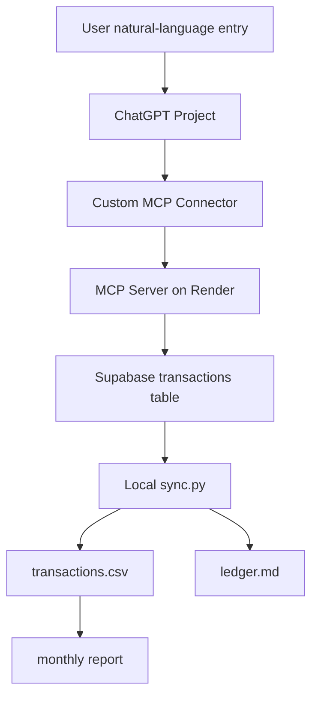

# ChatGPT Ledger MCP Template

A small **TypeScript MCP server template** for turning user-provided transactions into a structured ledger and exportable records.

[Project case study](https://icn1vad.github.io/projects/ledger-mcp/) · [Tool and workflow overview](docs/portfolio-overview.md)

This is a single-user template, not a claim of a hosted multi-user financial service. The example deployment's authentication and storage policies must be configured for the intended environment. Real personal ledgers are not part of this public repository.


A minimal MCP server template for building a personal bookkeeping Connector for ChatGPT.

It lets a user say natural-language entries such as:

```text
记一笔，今天咖啡 12.5，示例咖啡店
刚刚咖啡 12.5，示例咖啡店
把刚才那笔咖啡改成示例咖啡店
删除刚才那笔记错的账
```

ChatGPT calls MCP tools, the server writes structured transactions to Supabase, and local scripts can export CSV / Markdown / monthly reports.

## Features

- `add_transaction`: add an expense, income, or transfer
- `list_transactions`: list recent transactions
- `update_transaction`: update fields by transaction id
- `delete_transaction`: soft-delete a transaction
- `monthly_summary`: summarize spending by month
- `export_transactions`: export a date range for local sync
- Supabase storage with RLS policies
- Render deployment config
- Local CSV / Markdown / report scripts

Deletion is soft deletion: records get `deleted_at` and `deleted_reason`, while normal queries hide deleted rows.

## Architecture



## Project Structure

```text
.
├─ server/
│  └─ src/
│     ├─ index.ts
│     ├─ schema.ts
│     ├─ store.ts
│     ├─ summary.ts
│     └─ env.ts
├─ supabase/
│  └─ schema.sql
├─ scripts/
│  ├─ sync.py
│  ├─ analyze.py
│  └─ dedupe.py
├─ data/
├─ exports/
├─ reports/
├─ docs/
├─ .env.example
├─ render.yaml
├─ package.json
└─ tsconfig.json
```

## Quick Start

Install dependencies:

```bash
npm install
```

Copy the environment file:

```bash
cp .env.example .env
```

Fill in:

```text
SUPABASE_URL=https://your-project-id.supabase.co
SUPABASE_ANON_KEY=your-anon-key
```

Create the Supabase table by running:

```text
supabase/schema.sql
```

Build and start:

```bash
npm run build
npm run start
```

Local MCP endpoint:

```text
http://localhost:3210/mcp
```

Health check:

```text
http://localhost:3210/health
```

## Deploy to Render

Use this service setup:

```text
Runtime: Node
Build Command: npm install && npm run build
Start Command: npm run start
```

Environment variables:

```text
NODE_VERSION=22
SUPABASE_URL=https://your-project-id.supabase.co
SUPABASE_ANON_KEY=your-anon-key
```

After deployment, your Connector URL is:

```text
https://your-render-service.onrender.com/mcp
```

## ChatGPT Connector Setup

Create a custom Connector in ChatGPT developer mode:

```text
URL: https://your-render-service.onrender.com/mcp
Authentication: None
```

Recommended Project Instructions are in:

```text
docs/project-instructions.md
```

## Local Sync

Sync local files:

```bash
npm run sync:local
```

Generate reports:

```bash
npm run analyze
```

Outputs:

```text
data/transactions.csv
data/ledger.md
reports/YYYY-MM.md
```

## Security Notes

- Do not commit `.env`.
- Do not store API keys in ChatGPT prompts or project instructions.
- This template records only user-provided transactions; it does not connect to real payment accounts.
- If you expose a public MCP server, consider adding an app-level token or stronger authorization.
- Review the RLS policies in `supabase/schema.sql` before using this for sensitive data.

## Roadmap

See:

```text
docs/roadmap.md
```

## License

MIT
