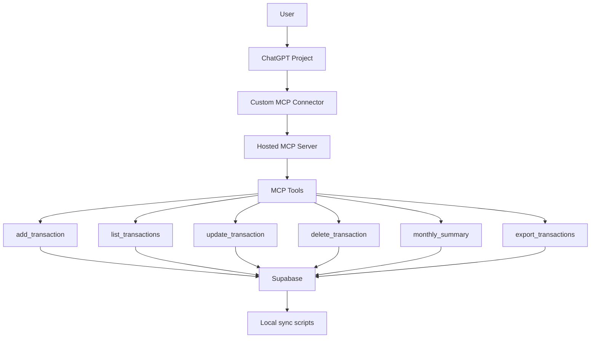
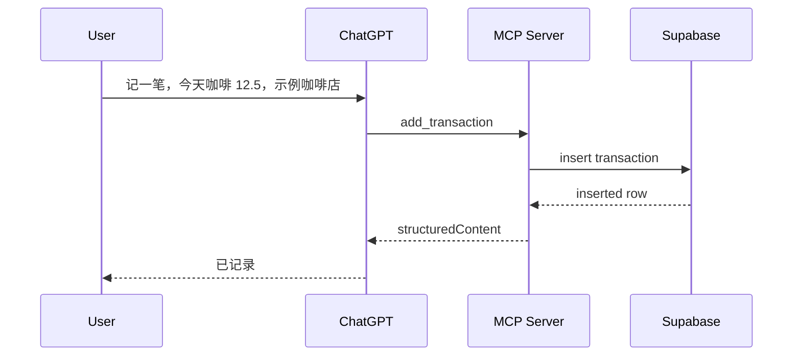

# Architecture and Implementation Notes

This document explains how the template works and what needs to be configured.

## Goal

```text
User natural-language bookkeeping
  -> ChatGPT custom MCP Connector
  -> Hosted MCP Server
  -> Supabase transactions table
  -> Optional local CSV / Markdown / report sync
```

The template does not connect to real bank or payment streams. It only records transactions explicitly provided by the user.

## System Diagram



## Request Flow



## Data Model

Main table:

```text
public.transactions
```

Important columns:

| Column | Purpose |
| --- | --- |
| `id` | text primary key |
| `occurred_at` | transaction date |
| `amount` | amount |
| `currency` | default `CNY` |
| `type` | `expense`, `income`, or `transfer` |
| `category` | category |
| `merchant` | merchant or platform |
| `account` | optional account |
| `payment_method` | optional payment method |
| `note` | short note |
| `raw_text` | original user text |
| `source` | default `chatgpt` |
| `created_at` | created timestamp |
| `updated_at` | updated timestamp |
| `deleted_at` | soft delete timestamp |
| `deleted_reason` | optional deletion reason |

## MCP Tools

```text
add_transaction
update_transaction
delete_transaction
list_transactions
export_transactions
monthly_summary
```

Write tools include MCP annotations:

```text
readOnlyHint=false
openWorldHint=false
destructiveHint=true for delete_transaction
```

Read tools use:

```text
readOnlyHint=true
```

## Storage Strategy

If `SUPABASE_URL` and `SUPABASE_ANON_KEY` are configured, the server reads and writes Supabase.

If they are missing, the server falls back to:

```text
exports/raw-transactions.json
```

This fallback is useful for local development only.

## Deployment

Any HTTPS Node hosting platform can run the server. The default docs use Render because it is simple for a first MCP endpoint.

Production commands:

```bash
npm run build
npm run start
```

## Common Issues

### Existing Supabase Table Has Missing Columns

Run the full migration:

```text
supabase/schema.sql
```

It uses `add column if not exists` so it can repair an older table.

### Existing Supabase `id` Is Numeric

The migration converts `id` to text:

```sql
alter table public.transactions
  alter column id type text using id::text;
```

### ChatGPT Does Not See New Tools

ChatGPT can cache Connector tool lists. Try:

1. Refresh the Connector.
2. Disconnect and reconnect.
3. Recreate the Connector.
4. Bump the MCP server version and redeploy.
